# Adreno740

先按[适配流程](/zh/porting/gpu)准备板级输入、修改源码、接入构建并逐步验证。

Adreno740 实现 SM8550 使用的 A740 内核 GPU 接口，管理命令提交、内存、fence 和 GPU 初始化。SoC 配置提供共享 GPU、GMU 和 SMMU 操作。各设备提供签名固件、电源策略、保留内存调整和显示集成。

已有硬件记录的设备为 sheng。其图形栈使用 4 KiB SMMU 翻译、GMU 固件、CP ring、fence 和 GPU 到 scanout 的合成。

## 运行时链路

```mermaid
flowchart LR
  A[iPadOS 应用] --> B[QuartzCore 和 RenderBox]
  B --> C[AdrenoMetal 插件]
  C --> D[metal2vulkan]
  D --> E[Turnip]
  E --> F[NIR 和 IR3]
  F --> G[Darwin KMD]
  G --> H[Adreno740]
  H --> I[GMU、CP、SMMU 和 ring]
  I --> J[Adreno 740]
  J --> K[GPU 合成到 scanout]
  K --> L[GopFramebuffer]
```



1. AdrenoMetal 通过系统 `MTLAddDevice` 发布 Metal 设备。发布模式把设备交回 backboardd，白名单进程获得各自的设备。它管理 Metal 对象、编码器、IOSurface、event、fence 和 pipeline archive。
2. metal2vulkan 把 AIR 翻译成 SPIR-V，并给出 pipeline 描述、binding 计划和 function constant。
3. Turnip 把 SPIR-V 经过 NIR 编译成 A740 IR3。Darwin KMD 通过 Adreno740 user client 访问内核。
4. Adreno740 管理 BO、GPU 地址、提交 ring、fence 和 SMMU context。GMU 让 GPU 退出 reset 并提交功耗票，CP 执行 IB。
5. 插件把完成帧合成到 scanout 页，GopFramebuffer 提供并回收 swap。

运行时编译链路是 Metal、AIR、SPIR-V、NIR、IR3。AirNir 是离线的 AIR 到 NIR 到 IR3 编译器。

## 发布到 render server

`scripts/add-gpu-plugin-data.py` 把插件写入打包 Data seed 的副本。

| 选项 | 作用 |
| --- | --- |
| `--publish` | 写入 `NativeAdrenoMetal.publish`。backboardd 把原生设备交回原有发现流程，CARenderServer 通过它合成系统界面。 |
| `--clients NAME,...` | 写入 `NativeAdrenoMetal.clients`。每个列入的进程获得自己的设备和驱动连接；其中最多两个还获得 256 MiB GPU 窗口和自己的 shader cache。`*` 表示所有进程。 |

发布模式关闭 backboardd 的 deep framebuffer 和压缩 framebuffer。补丁 `zzw-native-adreno-sandbox-grant` 让加速器服务在 `NativeSandboxGrantProcess` 中指定 render server，使其 user client 打开通过沙箱检查。

Adreno740 为每个连接提供一个 user-client core。render server 获得 `0x20000000` 处 1 GiB 窗口，最多两个列入的客户端各获得 256 MiB 及自己的队列范围和回收路径。

## 组件

| 组件 | 作用 |
| --- | --- |
| `drivers/AdrenoMetal` | Metal 前端、metal2vulkan、命令编码、IOSurface 和 scanout client |
| `drivers/Adreno740` | GPU 服务、GMU/CP 启动、user client、BO、VM、ring、提交和 fence |
| `drivers/GopFramebuffer` | swap 提供、校验、回收和 scanout hand-off |
| `kits/AdrenoFirmware` | GMU HFI、启动、功耗票和 SQE 固件数据 |
| `kits/AdrenoPM4` | A740 PM4 状态、常量、VPC 和 rasterizer 包 |
| `kits/ArmSmmu4K` | 原生 4 KiB 表、context、stream、live mapping 和 TLB 维护 |
| `kits/AirNir` | 离线 AIR 到 NIR 到 IR3 编译器 |

## 状态

| 步骤 | 结果 |
| --- | --- |
| GMU 冷启动和 HFI | 工作 |
| GPU context 和 CP 命令 | 工作 |
| 原生 4 KiB SMMU context | active |
| Metal 设备发现 | 工作 |
| GPU 帧复制到 scanout | 工作，像素一致 |
| render server 合成 | 工作 |
| 每进程 Metal 设备 | 工作 |
| GPU 合成桌面 | 工作 |

GPU 路径覆盖发现、命令编码、pipeline archive、IOSurface 导入、fence、合成和 scanout。render server 和列入的客户端使用原生设备。

## 内存与 TLB

| 项目 | 行为 |
| --- | --- |
| 每客户端对象数 | 只受内存限制，通过 handle 索引查找 |
| 自有 BO | 与 Metal 资源一样来自系统内存：没有内核映射的可分页内存，由 `prepare()` 锁定。VM 清零页面并一次批量设置 write-combined 属性，释放时恢复。客户端视图映射 BO 自己的描述符。没有固定池。映射时不做与已有区间的别名检查 |
| 导入内存 | 已映射的导入都属同一缓存类别，且其页都不在本驱动的 BO 中（覆盖 DRAM 的页位图）时，同样不做该检查；否则完整检查 |
| 解除映射 | 不超过 512 页逐页失效，更多时按 ASID 失效 |
| 提交 | 不做 TLB 失效；fence 卡住时仍会失效 |
| 启动日志行 | `[vm map]`、`[vm unmap]`、`[vm kinds]`、`[bo memory]` |

## 着色器编译

驱动在设备上编译原始 UI shader：

1. `default.metallib` 带有 AIR 和 Apple GPU 机器码，AIR 进入翻译路径。
2. metal2vulkan 把 AIR 翻译成 SPIR-V，Turnip 在 pipeline 创建时编译 IR3。
3. 冷启动会编译它遇到的每个 UI 变体。int-148：77 个 pipeline，约 43 s，cache hit 0。int-150：103 个 Metal pipeline，共 40.1 s，最大 1.40 s；94 个 Vulkan pipeline，共 23.3 s。
4. 补丁 `0004` 在 inlining 前特化 QuartzCore uber shader 并折叠常量加载。补丁 `0005` 保留最近的 module decode 和 device-profile fingerprint。pipeline journal 记录每次 render pipeline 创建。

已实现的缓解：

| 缓解 | 效果 |
| --- | --- |
| NDEBUG release 构建 | 去掉每 pass 后的 Mesa assertion 和 NIR 校验。 |
| metal2vulkan 补丁 `0004` | 在 Vulkan 编译前特化和裁剪 QuartzCore uber shader。 |
| metal2vulkan 补丁 `0005` | 保留最近的 module decode 和 device-profile fingerprint。 |
| priming cache | 缓存运行时启动 entry point 工作。 |
| `m2vpack` 导出和导入 | 复用之前编译的 pipeline cache；导出是增量的。 |
| Turnip builtin pack | 内嵌 clear、blit 和 empty shader 变体。 |
| pipeline journal | 记录每个 pipeline 的 CPU 时间、系统时间、page fault 和上下文切换。 |

cache 链路覆盖运行时启动和之前启动导出过的 UI 变体。新的 UI 变体编译一次后进入导出 cache。

## 构建

```sh
python3 scripts/build-turnip-darwin.py --target ios
python3 scripts/build-adreno-metal-plugin.py
python3 scripts/add-gpu-plugin-data.py --publish --clients <name,...> <seed>.dbr <output>.dbr
```

staging 脚本的输出是 `unixnu build payload --data-ramdisk` 使用的 Data seed。

主机检查：

```sh
python3 scripts/check-native-metal-frontend-host.py
python3 scripts/check-turnip-darwin-host.py
python3 scripts/check-smmu4k-live.py
python3 scripts/check-turnip-pipeline-cache-host.py
python3 scripts/check-priming-cache-host.py --output build/priming-cache/run
python3 scripts/probe-turnip-internal-compiler-host.py --qualification <old> --output <new>
```

设备仓库增加原始输入检查：

```sh
python3 scripts/build-adreno-compiler-host.py --probe
python3 scripts/build-turnip-ios-compiler-peer.py
python3 scripts/check-turnip-ios-compiler-cache.py
python3 scripts/check-quartzcore-turnip-cache-host.py
```

## 相关

- [小米平板 6S Pro（sheng）](/zh/devices/sheng)
- [XNU 驱动](/zh/drivers/xnu-drivers)
- [4 KiB 页表](/zh/xnu/four-k-page-tables)

开发中的辅助代码接受 A830 芯片 ID `0x44050001`，覆盖 ring／CP、中断、计时器及六缓冲区 GPU context。增大的 SQE 缓冲区和独立 AQE 缓冲区采用可执行映射。`NativeAdrenoA830HwInit` 配置 Gen8 保护、UBWC 和恢复状态，并在 ZAP 认证及安全模式退出 fence 完成后才标记就绪。一加 13T 板级代码已连接电源、GMU、SMMU 和服务发布。`scripts/check-adreno-a830.py` 已通过两代芯片的软件模型回归。一加 13T 较早的候选通过完整 XNU 编译和预链接，实机达到 GPU 就绪并完成 GPU 呈现，用户确认进入 UI；新的 parity 候选仍待生产构建和实机验证。

开发源码通过 `NativeAdrenoDiagnostics.h` 提供 `native_adreno_diagnostics`。非阻塞快照报告插件连接、最近打开进程、核心调用/状态及提交/fence 计数。方法编号与返回值成对采样。锁忙时返回上次成功快照并设置 `cached=1`；服务未发布、首次采样即锁忙或快照自身被占用时返回 false，保留输出不变。Fence poll miss 包含零超时未完成结果，不等同于 GPU 卡死。板级诊断可显示这些计数，无需等待 GPU 执行；它们不测量显示 FPS，也不证明像素正确。

普通用户 BO 从系统内存分配并固定物理页，不预留 BO 池，也不创建任务映射或永久内核映射；分配和释放在共享设备锁外进行。显式连续分配仍保留该要求。user-client 软件回归覆盖碎片页的映射、提交和回收，不代表实机性能结果。

诊断另行保留最近一次非零核心方法编号与返回值，后续成功调用不会清除它。这是历史记录，可能包含正常限时等待；需结合方法编号判断。

OnePlus 13T 的 Run 88 候选接入 GPU parity 分支的系统 BO、每进程页表和 Metal 缓冲区复用，保留 A830 的 SQE/AQE 与 Gen8 计数器差异。Metal 报告六个已配置 SP，板级通过原机 OPP 请求 389 MHz；实际活动核心数、频率和稳定 60 FPS 尚未验证。

同步 main a9a2cbb 后保留上游 A740 双环抢占实现；A830 明确拒绝该抢占配置，继续使用 Gen8 六缓冲区上下文、SQE/AQE 映射、复位/页表包和计数器地址。iPadOS 17 头文件缺少 GPU-role API 时使用现有前台提交优先级回退；新版头文件保留上游角色策略。
